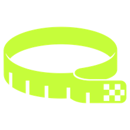
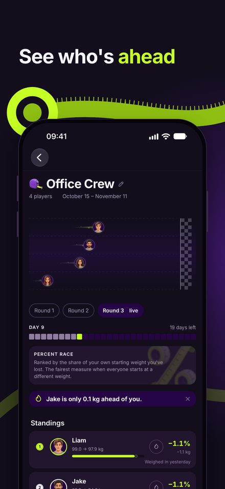
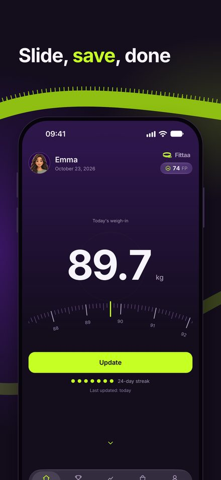
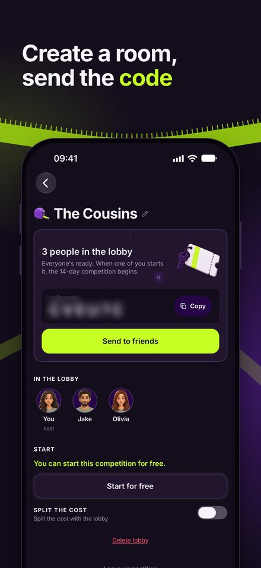
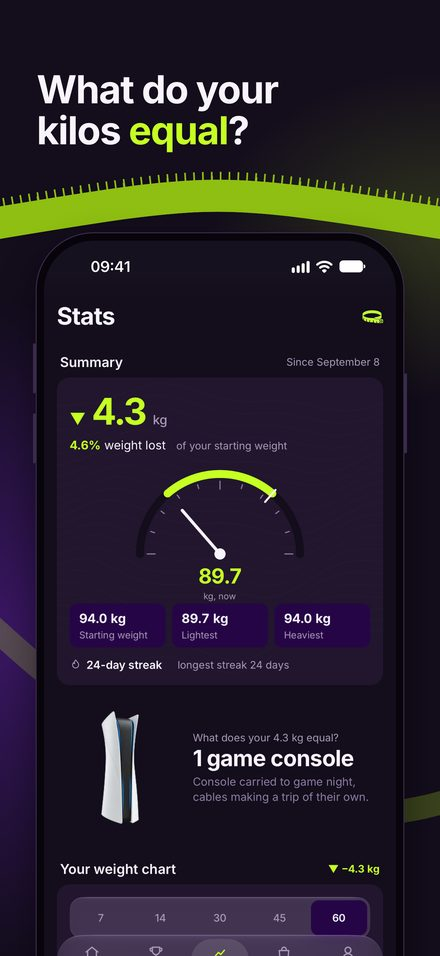
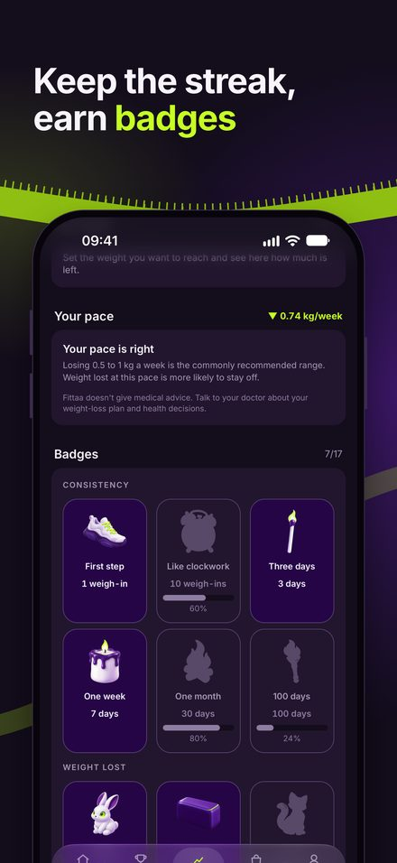
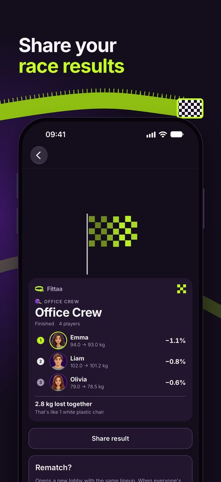

  

<h1 align="center">Fittaa</h1>

  <b>A weight-loss competition app for groups of friends.</b> 
  Weigh in once a day, see who's ahead, ask for a rematch.

  <a href="https://fittaa.netlify.app"><b>Download / website → fittaa.netlify.app</b></a>

  English | <a href="README.tr.md">Türkçe</a>

---

> **About this repository.** This is a portfolio page for Fittaa, an iOS app I
> designed and built. The app's source code is private and is not published
> here; this repository contains only a description, screenshots and brand
> assets. See [LICENSE](LICENSE).

## Screenshots

<table>
  <tr>
    <td></td>
    <td></td>
    <td></td>
  </tr>
  <tr>
    <td></td>
    <td></td>
    <td></td>
  </tr>
</table>

## What it does

Fittaa turns losing weight into a game you play with friends. Someone sets up
a competition, shares the invite code, picks the length and the rules. Everyone
weighs in once a day and the leaderboard updates on its own.

- **One weigh-in, every competition.** A weigh-in belongs to the user, not to a
  competition, so the same morning entry counts in all the competitions you're in.
- **Three ways to compete.** Percentage of starting weight (fair across different
  starting weights), absolute kilograms, or progress toward a shared target weight.
- **Teams and weekly stages.** Team score is the average of its members, so a
  bigger team doesn't win by default. Long competitions can be split into weekly
  stages so people who fall behind get a fresh chance.
- **Weight loss you can picture.** "You lost 3.6 kg" becomes "two classical
  guitars" or "a bag of flour".
- **Stats and badges.** Weight history chart, weekly change, BMI range, trend
  and forecast, streak and milestone badges, an optional monthly leaderboard.
- **Rematch.** When a competition ends, the same group can start the next round
  with one tap.

### Built with health in mind

Fittaa is a weight-*loss* competition, and that can be harmful for someone who
doesn't need to lose weight. The app enforces a healthy-weight floor (BMI 18.5):
people at or below it can't create, join or start competitions, their score
freezes at the floor instead of dropping out of the ranking, and the app points
them to a doctor rather than celebrating further loss.

## Built with

React Native, Expo and TypeScript for iOS. Available in seven languages:
Turkish, English, Spanish, Portuguese (BR), German, French and Italian.

## Status

iOS app, submitted to the App Store in October 2026.
Download links and updates: **[fittaa.netlify.app](https://fittaa.netlify.app)**

## Contact

Gökhan Aksu, fittaa.app@gmail.com

---

© 2026 Gökhan Aksu. All rights reserved. Fittaa name, logo and screenshots
may not be reused without permission.
