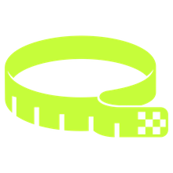
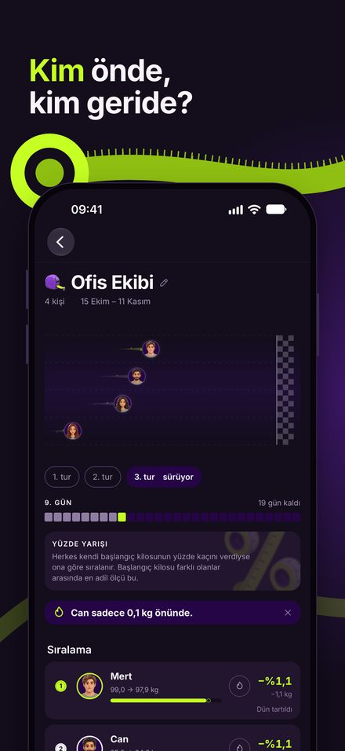
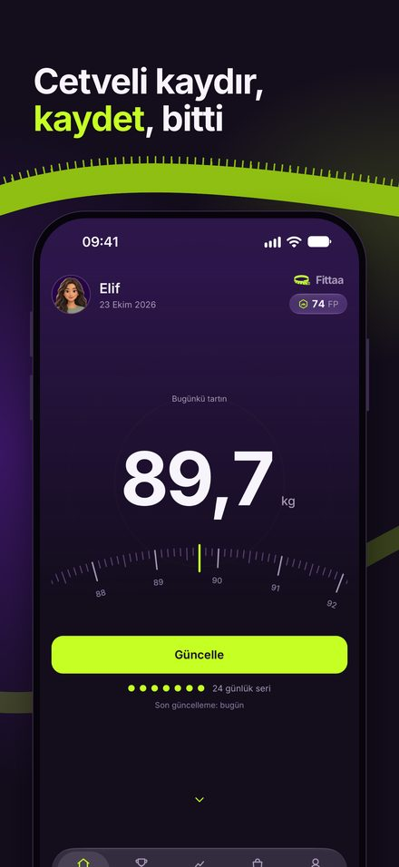
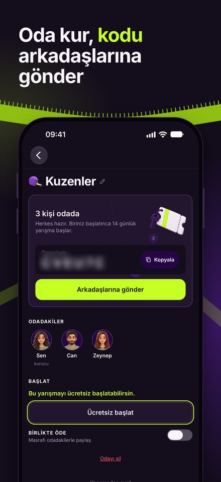
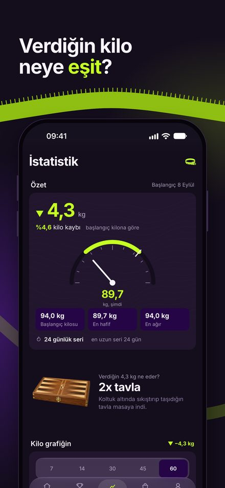
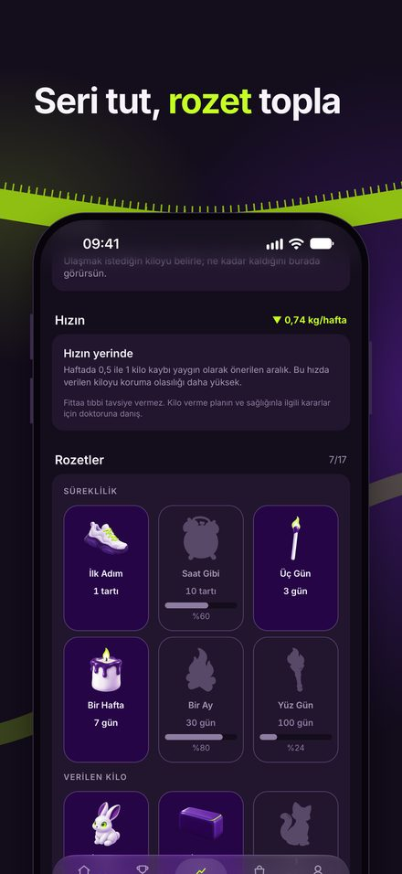
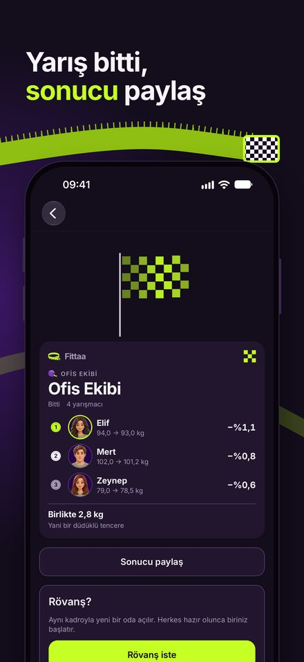

  

<h1 align="center">Fittaa</h1>

  <b>Arkadaşlarla kilo verme yarışı.</b> 
  Günde bir kere tartıl, kimin önde olduğunu gör, rövanş iste.

  <a href="https://fittaa.netlify.app"><b>İndir / web sitesi → fittaa.netlify.app</b></a>

  <a href="README.md">English</a> | Türkçe

---

> **Bu depo hakkında.** Burası, tasarlayıp geliştirdiğim iOS uygulaması
> Fittaa'nın portföy sayfası. Uygulamanın kaynak kodu gizli, burada
> yayımlanmıyor; depoda yalnızca tanıtım metni, ekran görüntüleri ve marka
> görselleri var. Ayrıntı için [LICENSE](LICENSE).

## Ekran görüntüleri

<table>
  <tr>
    <td></td>
    <td></td>
    <td></td>
  </tr>
  <tr>
    <td></td>
    <td></td>
    <td></td>
  </tr>
</table>

## Ne yapıyor

Fittaa, kilo vermeyi arkadaşlarınla oynadığın bir yarışmaya çeviriyor. Biri
yarışmayı kuruyor, davet kodunu paylaşıyor, süreyi ve kuralı seçiyor. Herkes
günde bir kere tartılıyor, sıralama kendiliğinden güncelleniyor.

- **Tek tartı, bütün yarışmalar.** Tartı kaydı yarışmaya değil kullanıcıya ait;
  sabah girdiğin kilo katıldığın her yarışmada sayılıyor.
- **Üç yarışma türü.** Başlangıç kilosunun yüzdesi (farklı kilolardan
  başlayanlar için adil), verilen kilo ya da ortak hedef kiloya yaklaşma.
- **Takım ve haftalık etap.** Takım puanı üyelerin ortalaması, kalabalık takım
  kendiliğinden kazanmıyor. Uzun yarışmalar haftalık etaplara bölünebiliyor,
  geride kalan her hafta yeniden şans buluyor.
- **Elle tutulur karşılık.** "3,6 kg verdin" yerine "iki klasik gitar" ya da
  "bir torba un".
- **İstatistik ve rozetler.** Kilo grafiği, haftalık değişim, VKİ aralığı,
  eğilim ve tahmin, seri ve kilo rozetleri, isteğe bağlı aylık genel sıralama.
- **Rövanş.** Yarışma bitince aynı ekip tek dokunuşla yeni tura başlıyor.

### Sağlık gözetilerek tasarlandı

Fittaa bir kilo *verme* yarışması; kilo vermesi gerekmeyen biri için zararlı
olabilir. Uygulama sağlıklı kilo sınırı uyguluyor (VKİ 18,5): sınırda ya da
altında olan kişi yarışma kuramıyor, katılamıyor, başlatamıyor. Puanı sınır
kilosunda donuyor ama sıralamadaki yerini kaybetmiyor; uygulama daha fazla kilo
vermeyi kutlamak yerine onu doktora yönlendiriyor.

## Kullanılanlar

iOS için React Native, Expo ve TypeScript. Yedi dilde: Türkçe, İngilizce,
İspanyolca, Portekizce (BR), Almanca, Fransızca ve İtalyanca.

## Durum

iOS uygulaması, Ekim 2026'da App Store'a gönderildi.
İndirme bağlantısı ve güncel bilgi: **[fittaa.netlify.app](https://fittaa.netlify.app)**

## İletişim

Gökhan Aksu, fittaa.app@gmail.com

---

© 2026 Gökhan Aksu. Tüm hakları saklıdır. Fittaa adı, logosu ve ekran
görüntüleri izinsiz kullanılamaz.
